# AI Sales and Back Office System for a Moving Company

Built by Gaps2Gains. We cut a moving company's inquiry reply time from 13.8 hours to 9 seconds. [Book a Free Discovery Call](https://gaps2gains.com/diagnosis)

**Client:** Lane Moving & Storage (Asian Tigers Philippines), a moving and storage company in Metro Manila
**Role:** AI Consultant, System Designer and Builder, by [Gaps2Gains](https://gaps2gains.com)

## The Results

**13.8 hours to 9 seconds**
Time to answer a new inquiry, day or night.

**386 leads**
From the website, Facebook, Instagram and WhatsApp, now in one CRM.

**US$9,350**
A corporate lead the AI Sales Agent found in its first 22 hours, one the team didn't know was waiting.

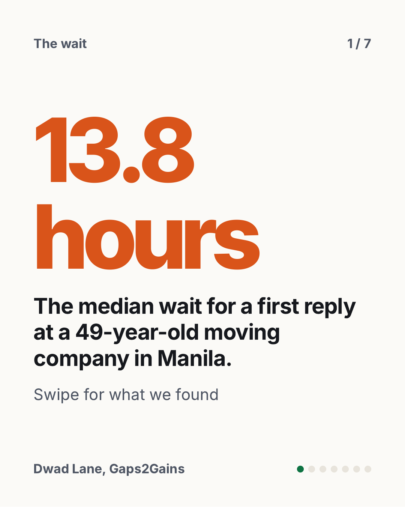 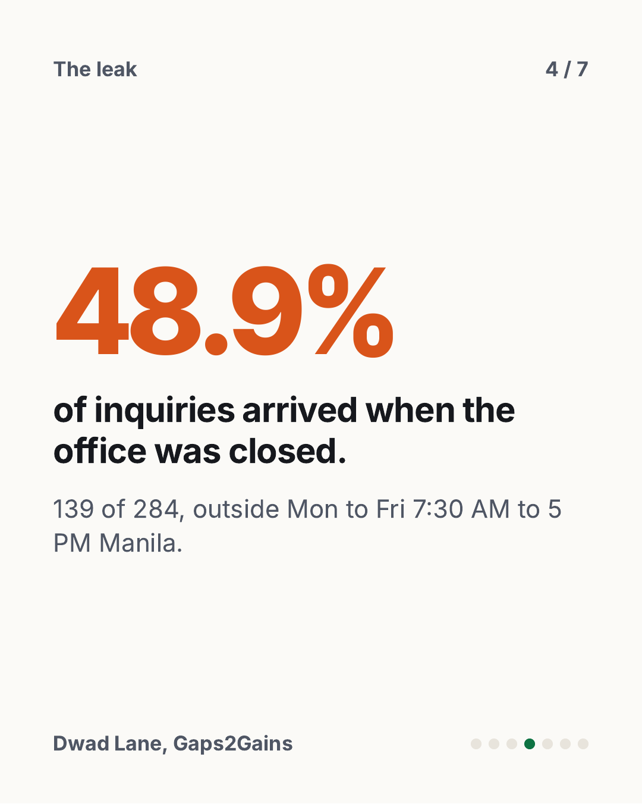 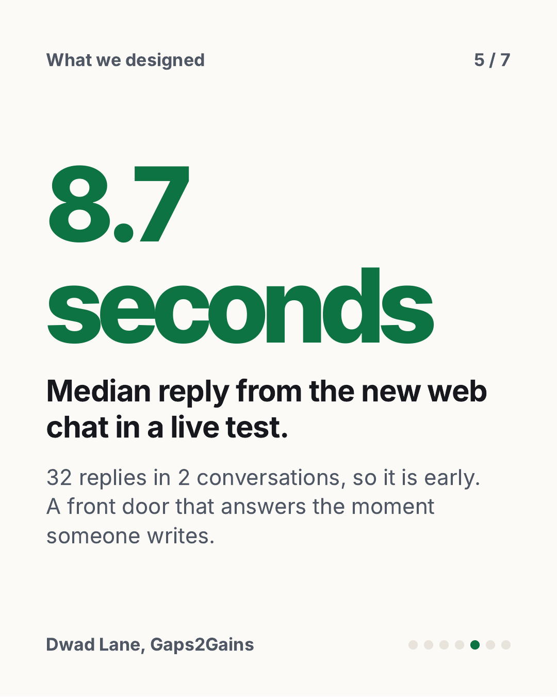

## The Gap

New inquiries waited 13.8 hours for a first reply. After-hours leads sat until morning, booking a home survey took days, and every quote was typed by hand. Leads came in on four channels and lived in four inboxes, so nobody could see who was still waiting.

## The System We Engineered

We designed one back office system. Six parts, each on tools the team already uses.

1. **Lisa, the AI receptionist.** Answers on every channel and hands the team a clean summary.
2. **Lisa Live, the AI video survey.** Walks the home room by room on video.
3. **AutoSurvey.** A self survey by phone video, no app.
4. **Quote Desk.** Turns each inquiry into a quote draft a person approves.
5. **GoHighLevel calendar and CRM.** One place for every lead, survey and follow-up.
6. **AI Sales Agent.** Flags the valuable leads nobody had spotted.

We also rolled out Claude Teams to staff. And we are moving the company from MYOB desktop to cloud accounting, connected through its API so invoices and payments stop being typed twice.

## How It Fits Together

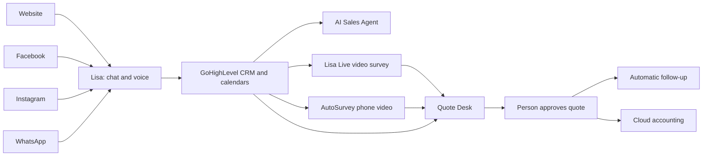

---

## 1. Lisa, AI Receptionist

Chat, voice, Facebook, Instagram and WhatsApp, all inside GoHighLevel.
Lisa asks the right moving questions, books the survey and hands the team a clean summary.

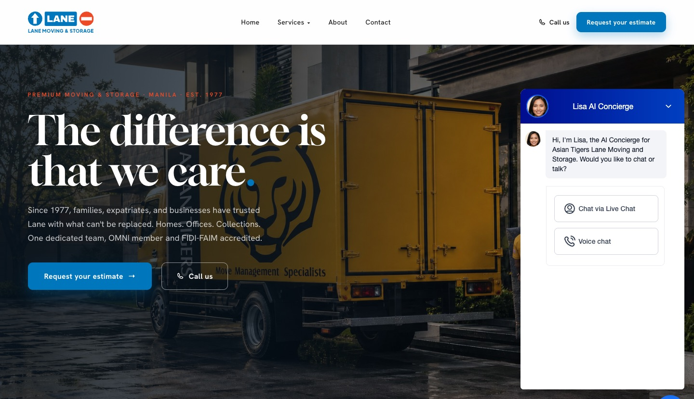

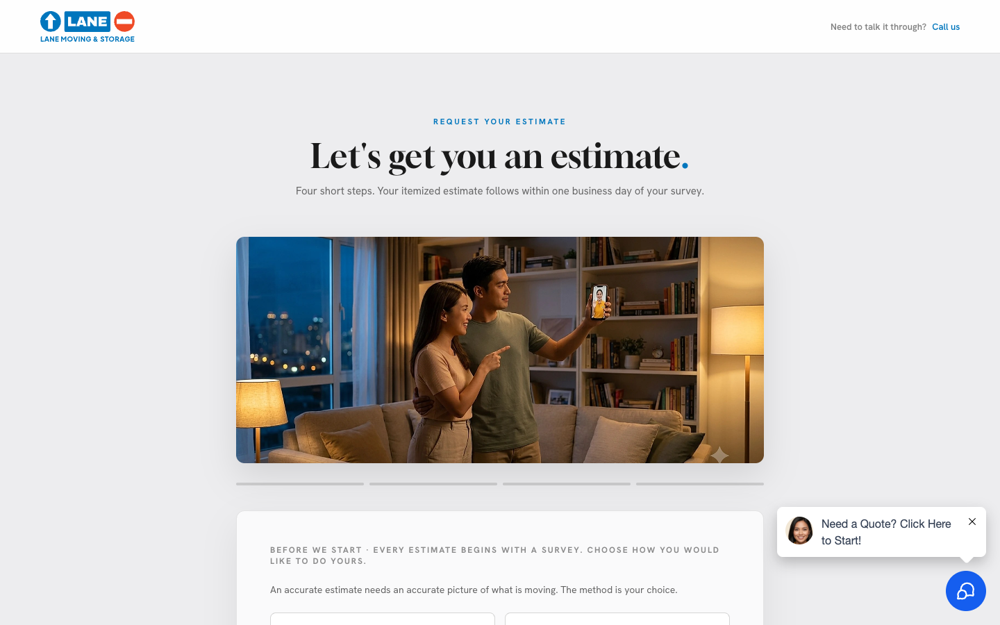 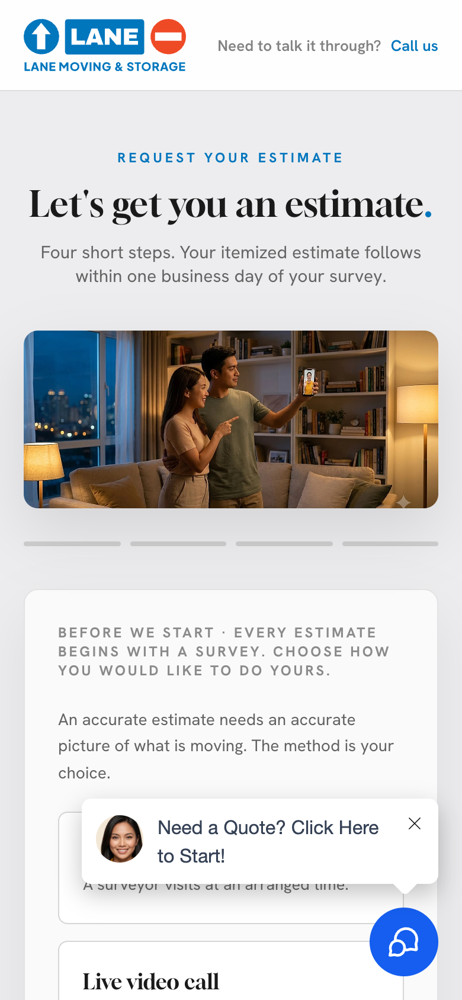

**Tech:** GoHighLevel Conversation AI and Voice AI, Claude.

**Measured:**
- Median reply 8.7 seconds (32 replies measured)
- Replies in the caller's language and saves in English
- 19 opportunities created by Lisa by Oct 28
- 98% capture accuracy in offline extraction tests

## 2. Lisa Live, AI Video Survey

The customer taps a link, Lisa joins on video and voice and walks the home room by room.
She leaves a counted inventory against a cube sheet and a draft quote. It is in pilot.

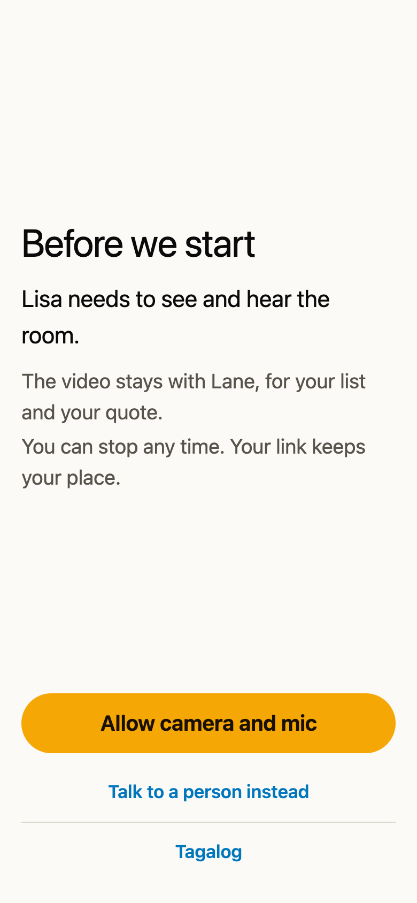 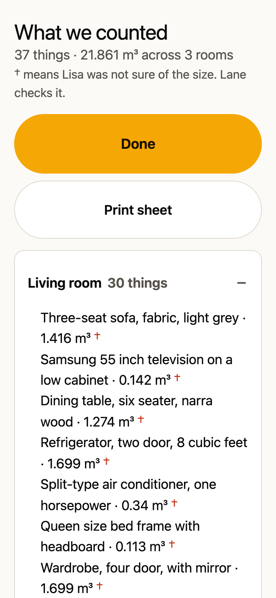

*Screens shown with demo data.*

**Tech:** Next.js, Gemini Live, Cloudflare.

**Measured:**
- A coverage sweep needs 85% of each room seen before moving on
- About US$0.02 in model cost for a 20-room survey (estimate)
- 6.7 second turn, measured locally

## 3. AutoSurvey, Self Survey by Phone Video, No App

The customer films each room on their phone. A vision model lists the items, the cube sheet gives volume and weight, and a rep reviews it.
The AI never guesses size. It only says what it sees.

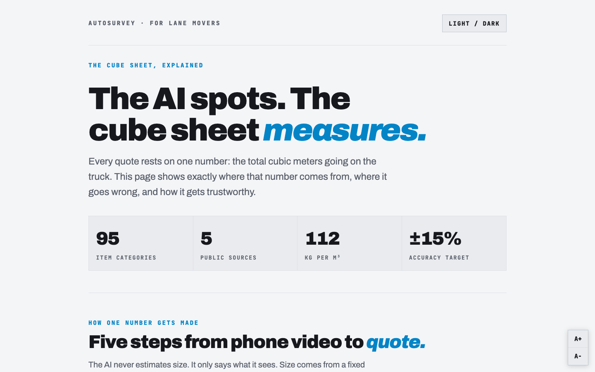

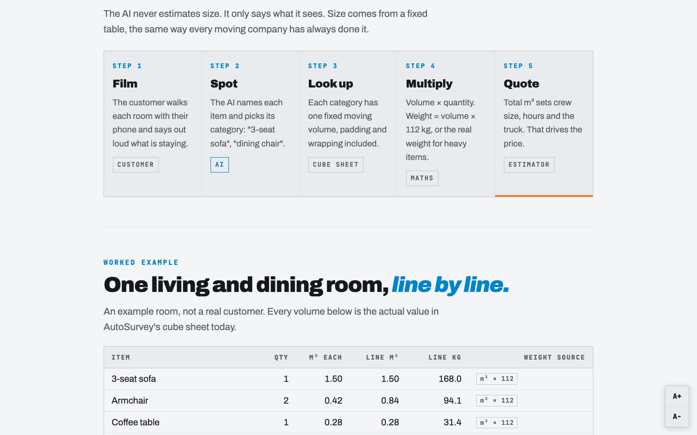

**Tech:** A vision model, a fixed cube sheet, a rep review step.

**Measured:** In its first unscripted test it caught 13 of 14 items, plus about 10 the human surveyor missed.

## 4. Quote Desk

Every GoHighLevel inquiry becomes a quote draft for a person to approve, then follows up on its own.
Pricing is deterministic, with no AI in the price path.

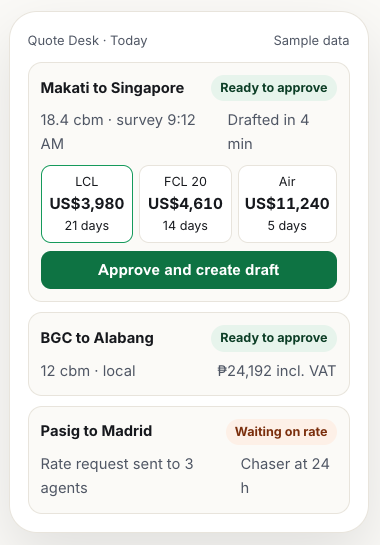 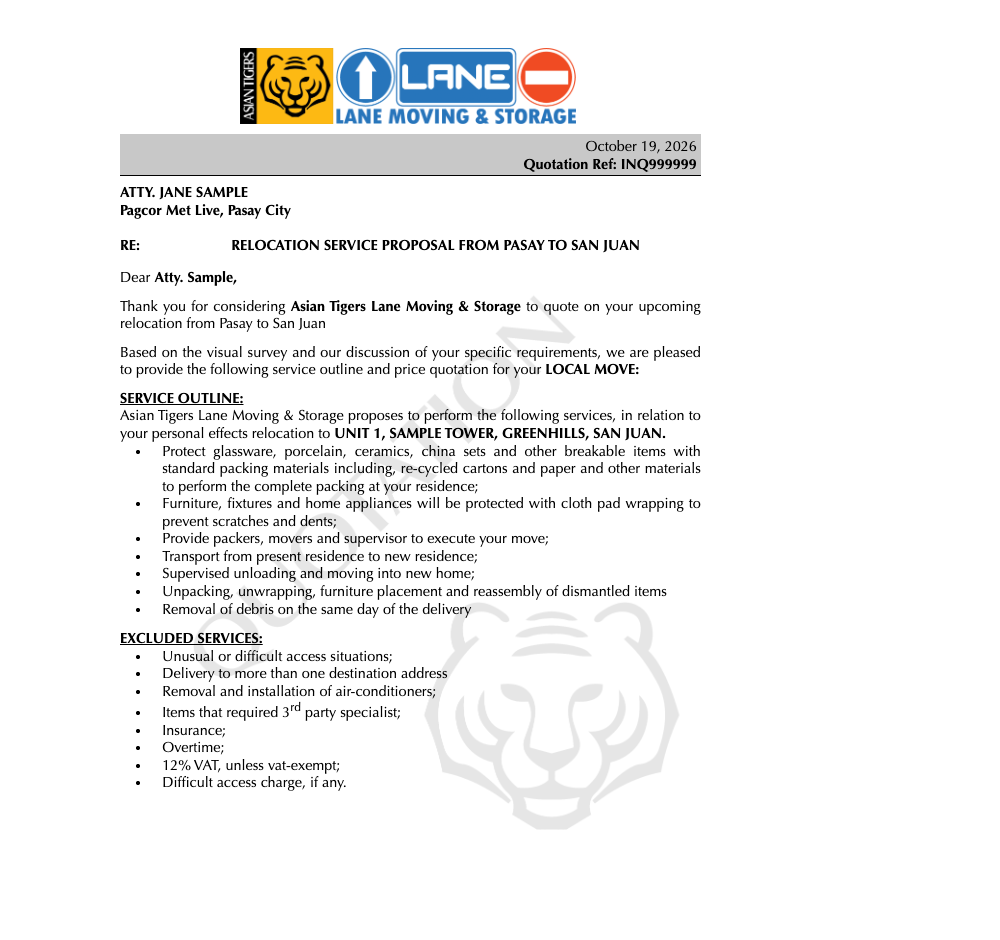 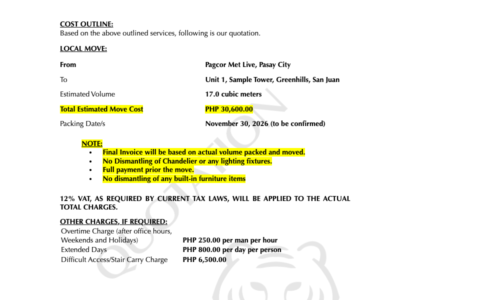

*Sample data and a sample customer.*

**Tech:** JavaScript and Python pricing engines, GoHighLevel documents and workflows, a dedicated box behind Cloudflare Tunnel and Access.

**Measured:**
- 801 automated tests
- A JavaScript and Python pricing engine that agree on 720 test cases

## 5. GoHighLevel Calendar and CRM

One CRM for every lead, with calendars, reminders and alerts wired in.

**Tech:** GoHighLevel, plus a command line tool that reads, diffs, sandbox-tests and restores GoHighLevel config with receipts.

**What we built:**
- Round-robin Onsite Survey calendars
- Appointment status that moves the pipeline stage
- 24-hour reminder workflows
- Owner assignment and no-booking alerts
- A command line tool that reads, diffs, sandbox-tests and restores GoHighLevel config with receipts

**Measured:** 386 leads in the CRM by Oct 28, up from 2 of 278 on Oct 4. The pipeline now holds 378 opportunities.

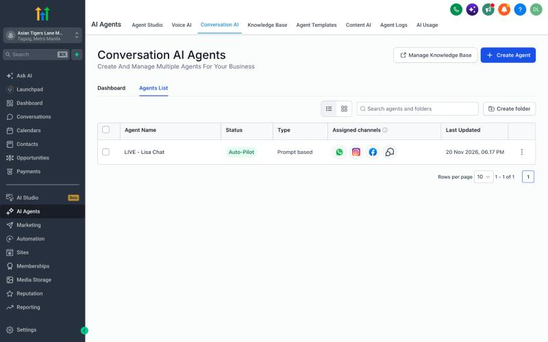
*Lisa Chat, live on Auto-Pilot across WhatsApp, Instagram, Facebook and website chat.*

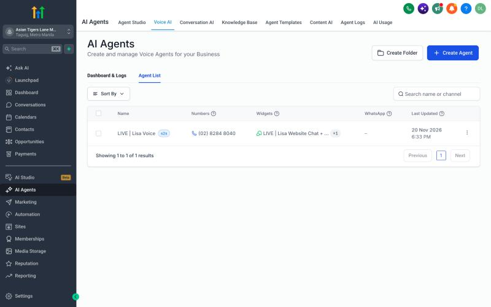
*Lisa Voice, live on the main business number and the website widget, speech to speech.*

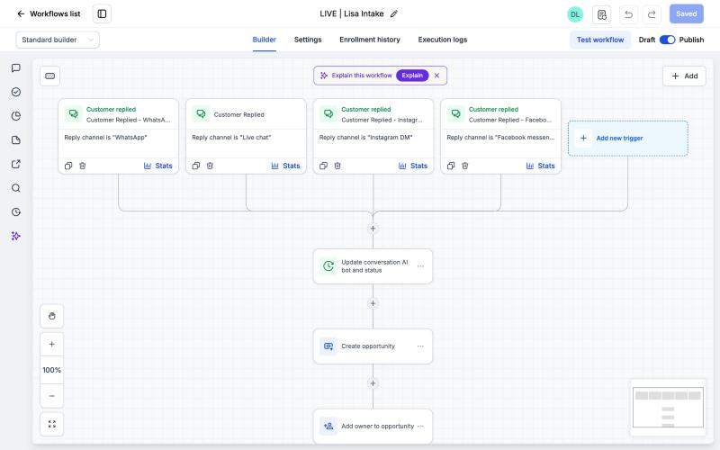
*The Lisa Intake workflow: a reply on any of 4 channels updates the AI bot status, creates the opportunity and assigns an owner.*

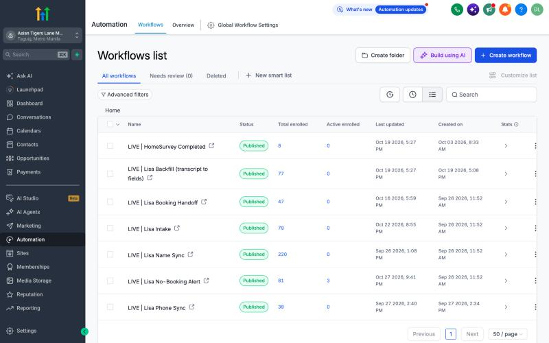
*The live Lisa workflows: Intake, Booking Handoff, Name and Phone Sync, No-Booking Alert, and HomeSurvey Completed. Name Sync alone has run 220 times.*

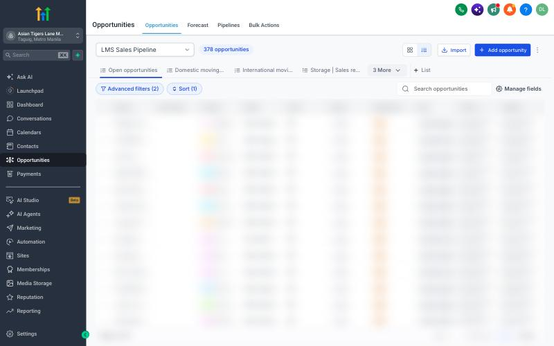
*The sales pipeline, split into Domestic, International and Storage. Customer details are blurred.*

## 6. AI Sales Agent

Reads old and new inquiries and flags the valuable ones, such as corporate and international moves.

**Measured:** Found a US$9,350 corporate lead in its first 22 hours.

## Claude Teams Rollout

We rolled out Claude Teams to staff, with role-based setups for Sales, Operations and Accounting.
See the kit: [dwadlane/claude-teams-rollout-kit](https://github.com/dwadlane/claude-teams-rollout-kit).

---

## Built With

GoHighLevel, Conversation AI and Voice AI, Claude, Gemini Live, Next.js, Cloudflare, JavaScript, Python, accounting APIs.

The code holds real customer data, so it stays private. This page shows the system and what it does.

**Live walkthrough on a call.** We show the working system on a screen share.

Want a system like this for your business? [Book a Discovery Call](https://gaps2gains.com/diagnosis).
