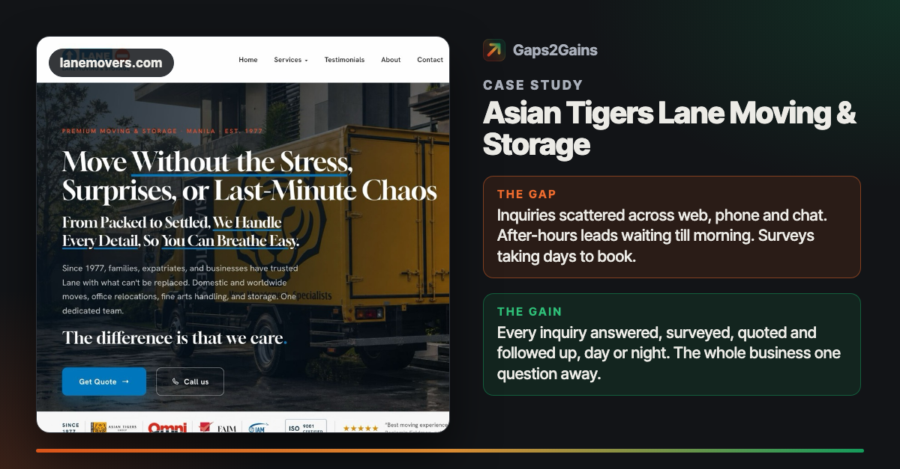
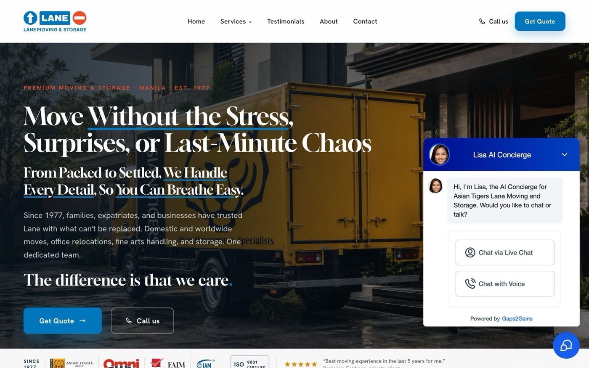
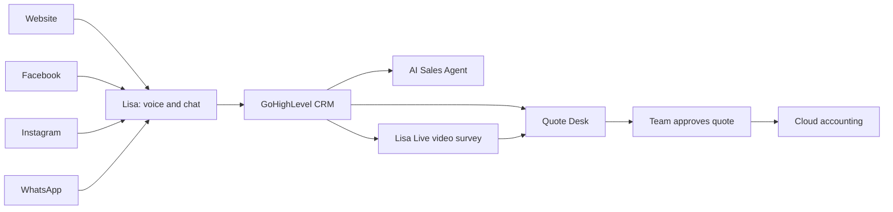

# AI Sales and Back Office System for a Moving Company

Built by Gaps2Gains. We cut a moving company's inquiry reply time from 13.8 hours to 9 seconds. [Book a Free Discovery Call](https://gaps2gains.com/diagnosis)

**Client:** Asian Tigers Philippines, a moving and storage company in Metro Manila
**Role:** AI Consultant, System Designer and Builder, by [Gaps2Gains](https://gaps2gains.com)

## The Results

**13.8 hours to 9 seconds**
Time to answer a new inquiry, day or night.

**386 leads**
From the website, Facebook, Instagram and WhatsApp, now in one CRM.

**US$9,350**
A corporate lead the AI Sales Agent found in its first 22 hours, one the team didn't know was waiting.

## The Gap

New inquiries waited 13.8 hours for a first reply. After-hours leads sat until morning, booking a home survey took days, and every quote was typed by hand. Leads came in on four channels and lived in four inboxes, so nobody could see who was still waiting.

## The System We Engineered

1. **Lisa, the AI receptionist.** Answers by voice and chat in about 9 seconds across the website, Facebook, Instagram and WhatsApp. She asks the right moving questions, books surveys and hands the team a clean summary.
2. **One CRM for every lead.** Every channel flows into GoHighLevel pipelines, with alerts so nothing sits unanswered.
3. **AI Sales Agent.** Reads old and new inquiries and flags the valuable ones, such as corporate and international moves.
4. **Quote Desk.** Turns each inquiry into an accurate quote draft for a person to approve, then follows up on its own.
5. **Lisa Live, the AI video survey.** The customer taps a link, Lisa joins on video, walks the home room by room, and leaves a counted inventory and a draft quote.
6. **Claude for the whole team.** We rolled out Claude Teams to staff, with role-based setups for Sales, Operations and Accounting.
7. **Accounting automation.** We're moving the company from MYOB desktop to cloud accounting, connected through its API so invoices and payments stop being typed twice.

## How It Fits Together

## Built With

GoHighLevel, Conversation AI and Voice AI, Claude, Gemini Live, Next.js, Cloudflare, Python, accounting APIs.

The code holds real customer data, so it stays private. This page shows the system and what it does.

Want a system like this for your business? [Book a Discovery Call](https://gaps2gains.com/diagnosis).
